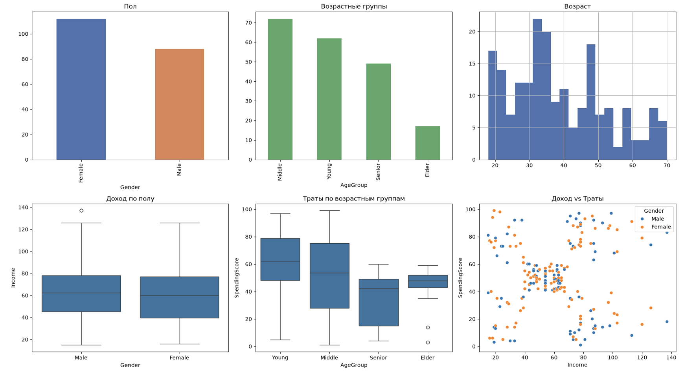

# Customer Segmentation Analysis

Разведочный анализ клиентов торгового центра на основе датасета Mall Customers.

## О проекте

Цель — понять, какие группы клиентов существуют, кто тратит больше всего,
и как это можно использовать для маркетинга.

**Инструменты:** Python, Pandas, Matplotlib, Seaborn, Jupyter Notebook.

## Структура

- `data/Mall_Customers.csv` — исходные данные (200 клиентов)
- `customer_analysis.ipynb` — ноутбук с полным анализом
- `images/` — графики и визуализации

## Ключевые выводы

1. **Доход не связан с тратами** — корреляция ≈ 0.01.
2. **Молодые клиенты (18–30) тратят больше всех** — средний Spending Score 61.
3. **5 сегментов клиентов** видны на графике Income vs SpendingScore.
4. **Самые перспективные группы:** VIP (высокий доход + высокие траты)
   и «богатые-экономные» (есть деньги, но не тратят).

## Пример визуализации



## Бизнес-рекомендации

1. Программа лояльности для VIP-клиентов.
2. Персонализированные предложения для «богатых-экономных».
3. Молодёжные акции для клиентов 18–30.
4. Рассрочки для активных, но небогатых клиентов.

## Как запустить

```bash
git clone https://github.com/ebasnev2016-dot/customer-segmentation.git
cd customer-segmentation
jupyter notebook customer_analysis.ipynb
```

## Ограничения

- Датасет всего 200 строк — выводы осторожные.
- Корреляция != причинность.

## Автор

Баснев Егор [GitHub](https://github.com/ebasnev2016-dot)